

# ☁️ TP13 - AWS Local, SDK & Terraform
### Floci, AWS CLI, Terraform, OpenTofu & Scan IaC

📄 **[Télécharger le rapport complet (PDF)](rapport_tp13.pdf)**

---

## 🎯 Objectifs du TP

Ce TP a pour but de maîtriser l'utilisation d'un émulateur AWS local (Floci) et de Terraform :

- **AWS CLI** : Manipuler S3, SQS, DynamoDB, Secrets Manager et Lambda.
- **SDK JavaScript** : Interagir avec Floci via Node.js et Docker Compose.
- **Terraform** : Provisionner des ressources AWS sécurisées (bucket S3, file SQS, table DynamoDB, secret).
- **Backend S3** : Stocker le state à distance avec verrouillage DynamoDB.
- **Scan IaC** : Détecter les mauvaises configurations avec Checkov et Trivy.
- **OpenTofu** : Rejouer le cycle avec le fork open-source de Terraform.

---

## 📝 Description

Le projet simule un environnement AWS complet en local avec Floci :
1.  Création de ressources avec la **CLI AWS**.
2.  Automatisation avec un **SDK Node.js** et **Docker Compose**.
3.  Infrastructure as Code avec **Terraform** (modules, environnements, backend S3).
4.  Audit de sécurité avec **Checkov** et **Trivy**.
5.  Migration vers **OpenTofu**.

---

## 📸 Captures d'écran

Toutes les captures sont disponibles dans le dossier [`captures/`](captures/).

### 🛠️ Partie 1 : AWS CLI contre Floci

#### 1. Configuration du profil Floci
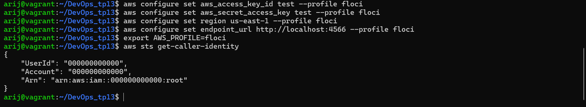

#### 2. S3 (Bucket, upload, list)
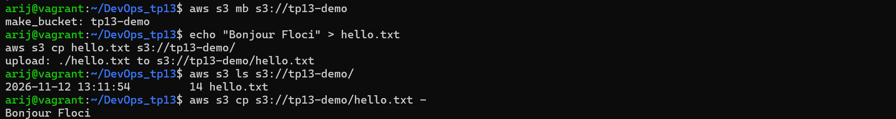

#### 3. SQS (Queue, send, receive)
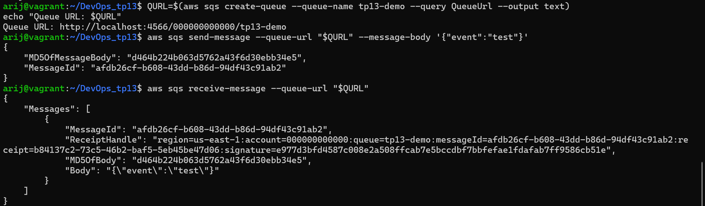

#### 4. DynamoDB (Création de la table)
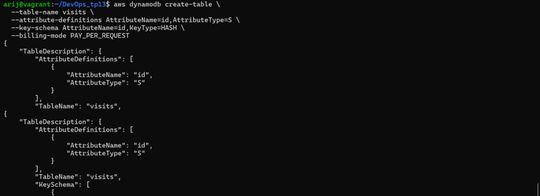

#### 4b. DynamoDB (Insertion et scan)
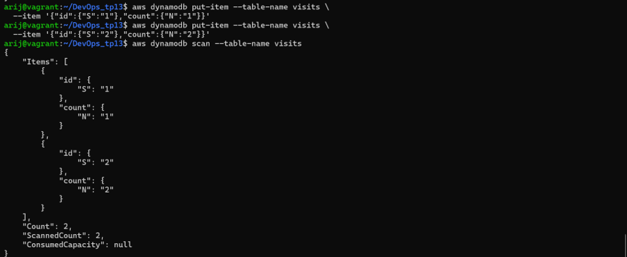

#### 5. Secrets Manager (Create, get)
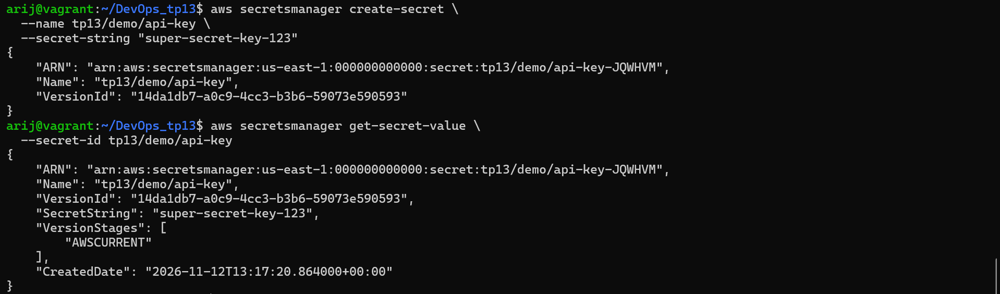

#### 6. Lambda (Création de la fonction)
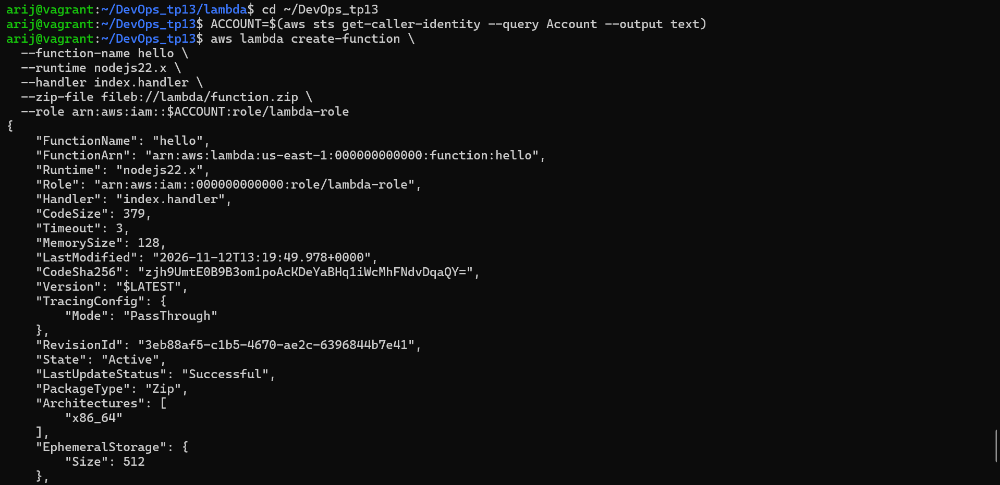

#### 6b. Lambda (Invocation)
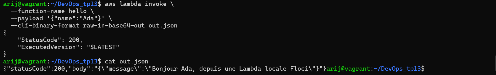

### 📦 Partie 2 : SDK JavaScript

#### 7. Script SDK (S3 + SQS)
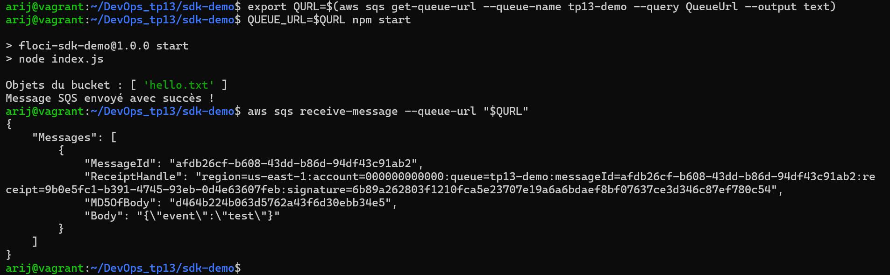

#### 8. Docker Compose (Floci + SDK)
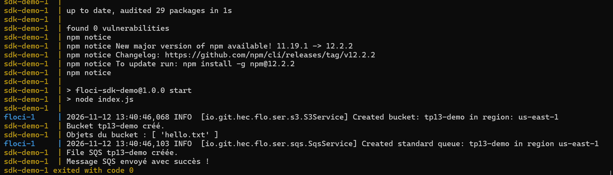

### 🏗️ Partie 3 : Terraform

#### 9. Apply Terraform (Ressources créées)
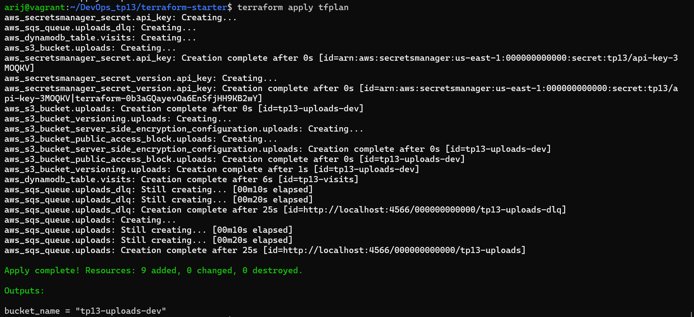

#### 10. Outputs Terraform
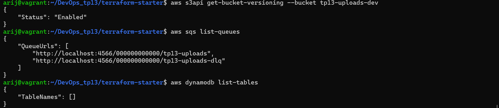

#### 11. Drift (Suppression manuelle + Plan)
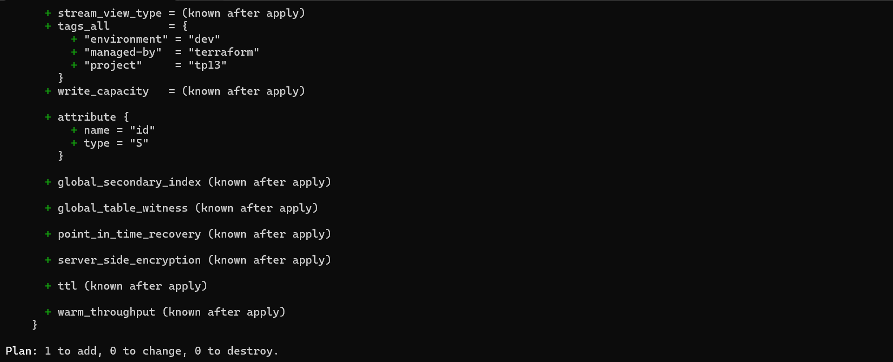

### 📦 Partie 4 : Modules et Backend S3

#### 12. Module S3 (Uploads + Backups)
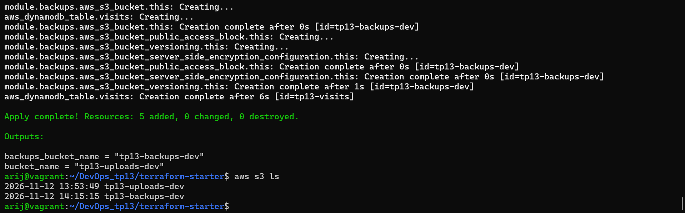

#### 13. Backend S3 (State migré)
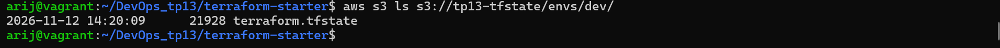

#### 14. Verrouillage (State Lock)
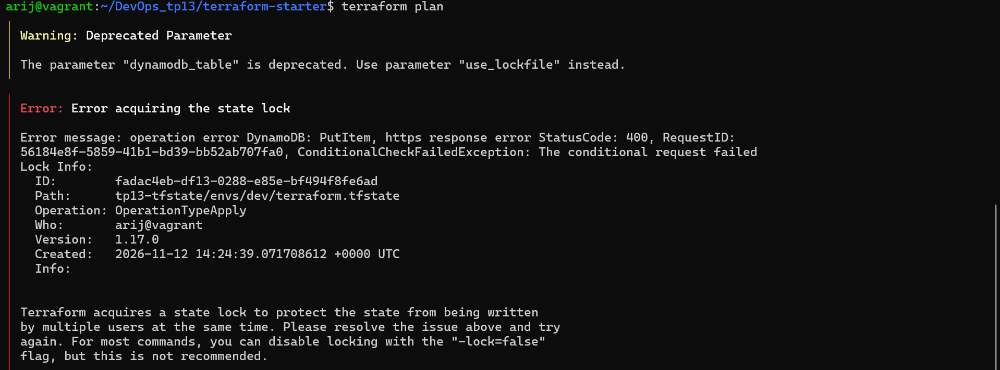

### 🛡️ Partie 5 : Scan IaC et OpenTofu

#### 15. Scan Checkov (Avant)
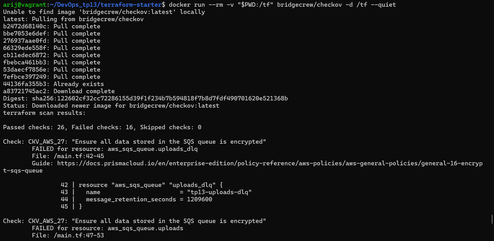

#### 16. Scan Trivy (Avant)
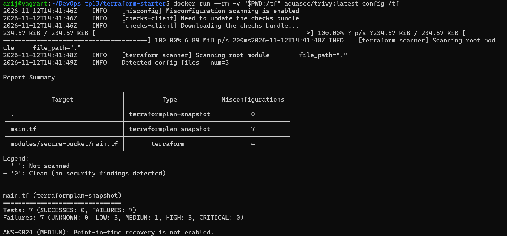

#### 17. Scan Checkov (Après failles)
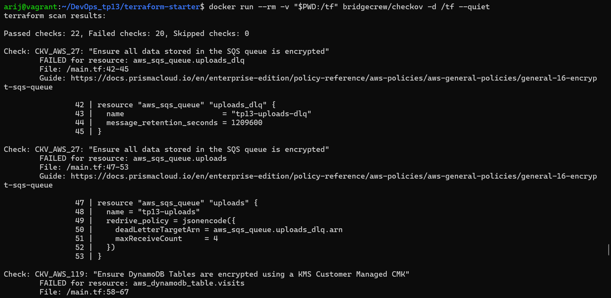

#### 18. Scan Trivy (Après failles)
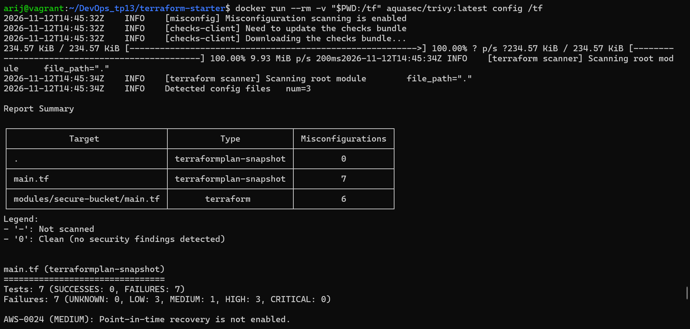

#### 19. Restauration du code sécurisé
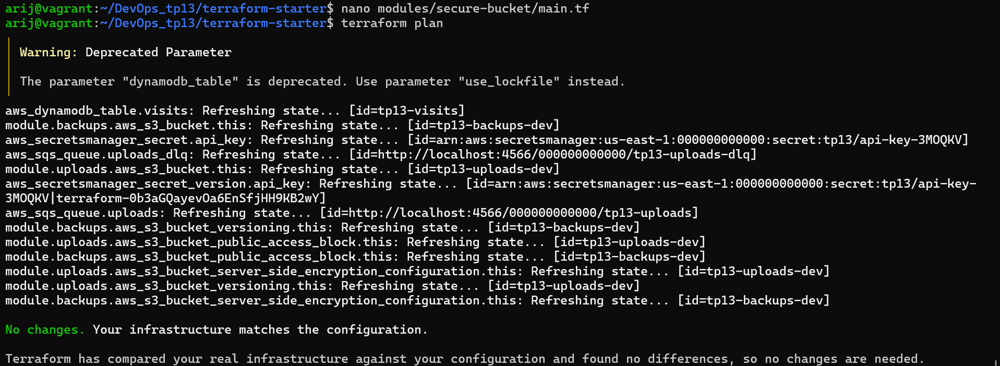

#### 20. Installation d'OpenTofu
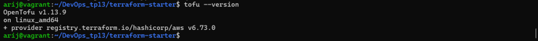

#### 21. Apply avec OpenTofu
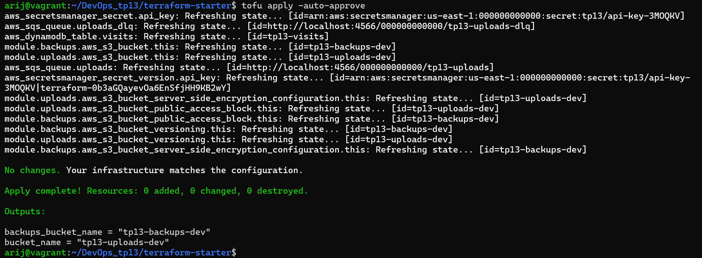

#### 22. Destroy (Nettoyage)
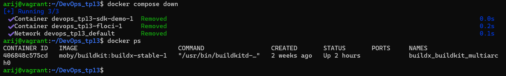

---

## 📊 Tableau comparatif : Floci vs LocalStack vs AWS Réel

| Critère | Floci | LocalStack (Community) | AWS Réel |
| :--- | :--- | :--- | :--- |
| **Licence** | MIT (open-source, gratuit) | Freemium (token requis) | Payant (à l'usage) |
| **Services couverts** | 1 850+ tests (S3, SQS, DynamoDB, Lambda, RDS, etc.) | Large couverture, certains services réservés à la version Pro | Tous les services AWS |
| **Fidélité** | Très bonne pour les tests locaux | Très bonne (référence du marché) | Parfaite (c'est le vrai AWS) |
| **Coût** | Gratuit (auto-hébergé) | Gratuit en communauté | Facturation à l'usage (peut être élevé) |
| **Usage en CI** | Idéal (léger, rapide) | Possible (token requis) | Déconseillé (coût, lenteur) |

## 📊 Tableau comparatif : Terraform vs OpenTofu

| Critère | Terraform (v1.17.0) | OpenTofu (v1.13.9) |
| :--- | :--- | :--- |
| **Licence** | BUSL (Business Source License) | MPL 2.0 (open-source) |
| **Compatibilité** | Référence | Lit les fichiers `.tf` et le state Terraform 1.x |
| **Chiffrement du state** | Non natif | **Natif** (v1.7+) : AES-GCM côté client |
| **Providers** | Registry officiel | Même registry (a utilisé `hashicorp/aws v6.73.0`) |
| **Fonctionnalités propres** | N/A | `for_each` sur les providers, `-exclude` |

---

  <b>Fait avec ❤️ par Arij Belaid</b>

